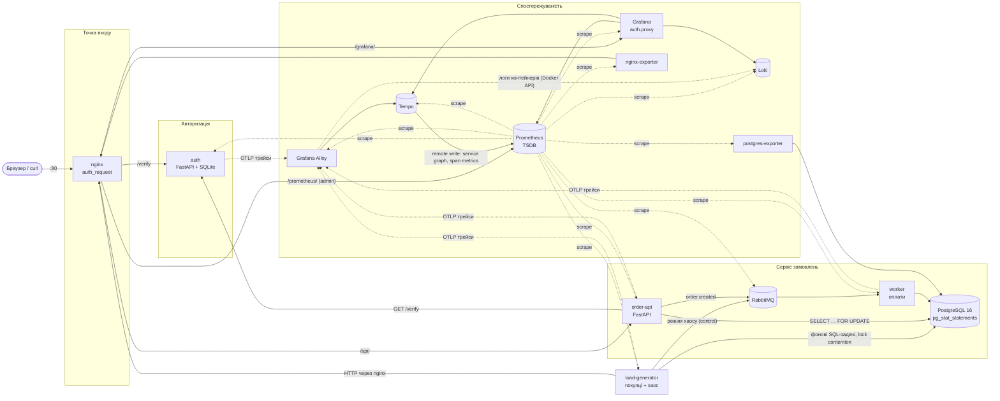
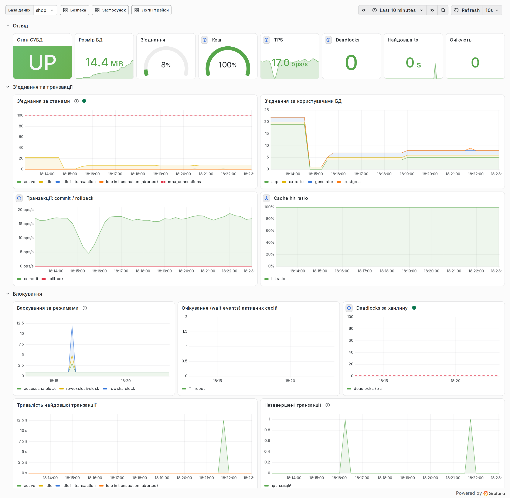
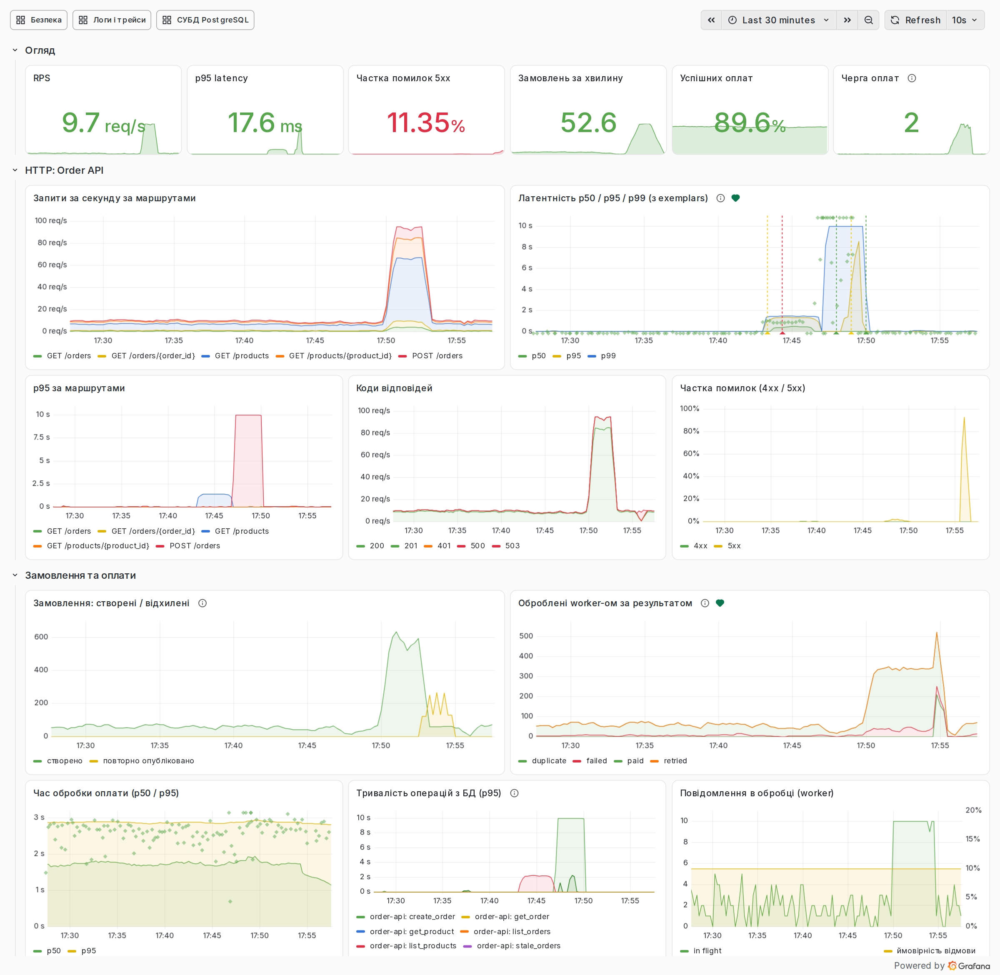
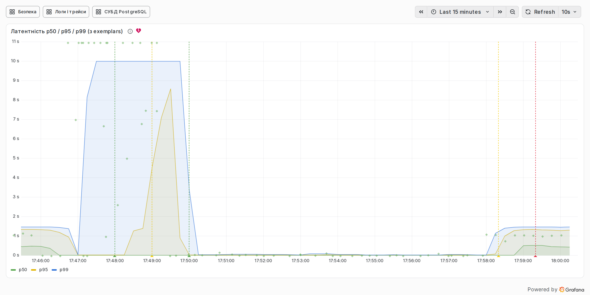
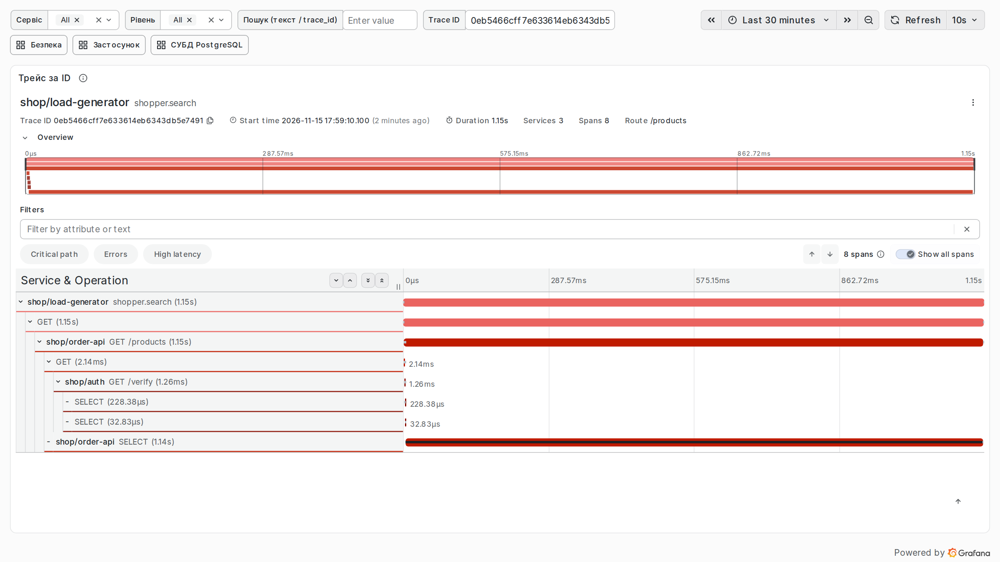

# Система моніторингу продуктивності СУБД PostgreSQL сервісу обробки замовлень інтернет-магазину

Курсова робота з дисципліни «Інформаційні системи».

Навчальний, але повноцінний стек спостережуваності (observability) для PostgreSQL. Сервіс замовлень інтернет-магазину працює під навантаженням, яке генерує програма на Python. Метрики, логи й трейси всіх компонентів збираються в Prometheus, Loki і Tempo та візуалізуються в Grafana, а пов'язані сигнали з'єднані переходами між собою. Доступ до системи мають лише користувачі, які авторизувалися на власному сервері авторизації. Окремий режим «хаосу» відтворює типові проблеми продуктивності БД, щоб показати їх на дашбордах і в алертах.

Усе працює в Docker і запускається однією командою.

---

## Зміст

- [Архітектура](#архітектура)
- [Запуск](#запуск)
- [Облікові записи та доступ](#облікові-записи-та-доступ)
- [Відповідність вимогам викладача](#відповідність-вимогам-викладача)
- [Сценарій демонстрації на захисті](#сценарій-демонстрації-на-захисті)
- [Режими хаосу](#режими-хаосу)
- [Дашборди й алерти](#дашборди-й-алерти)
- [Сервіси](#сервіси)
- [Структура репозиторію](#структура-репозиторію)
- [Версії компонентів](#версії-компонентів)
- [Команди Makefile](#команди-makefile)
- [Типові проблеми](#типові-проблеми)

---

## Архітектура



### Потоки даних

| Сигнал | Шлях |
|---|---|
| **Метрики** | Сервіси віддають `/metrics` (`prometheus_client`, формат OpenMetrics з exemplars) → Prometheus scrape кожні 15 с → вбудована TSDB (retention 15 днів). Метрики СУБД дає `postgres-exporter` (`pg_stat_activity`, `pg_stat_database`, `pg_locks`, `pg_stat_statements`, розміри таблиць). |
| **Логи** | Усі сервіси пишуть у stdout JSON з полями `level`, `service`, `trace_id`, `span_id` → Docker → Alloy (`loki.source.docker`) → Loki. Мітки `service` і `level`, а `trace_id` зберігається як structured metadata. |
| **Трейси** | OpenTelemetry SDK з автоінструментацією FastAPI, httpx, psycopg, aio-pika і sqlite3 → OTLP/HTTP → Alloy → Tempo. Контекст передається в заголовках HTTP і в заголовках повідомлень RabbitMQ, тому вся операція покупця складається в **один трейс**. |
| **Кореляції** | exemplar на графіку латентності → трейс у Tempo; `trace_id` у рядку логу → трейс; спан у трейсі → логи цього трейсу; Tempo service graph і span metrics → Prometheus. |

Приклад наскрізного трейсу `shopper.create_order` (17 спанів):

```text
[load-generator] shopper.create_order
  [load-generator] POST                         ← HTTP через nginx
    [order-api] POST /orders
      [order-api] GET → [auth] GET /verify      ← перевірка JWT (+ SELECT у SQLite)
      [order-api] SELECT … FOR UPDATE / INSERT / UPDATE   ← PostgreSQL
      [order-api] orders,order.created send     ← RabbitMQ
        [worker] orders receive
          [worker] INSERT payments
          [worker] payment.gateway              ← імітація оплати 0.5–3 с
          [worker] SELECT … FOR UPDATE / UPDATE ← PostgreSQL
```

### Як це виглядає

| | |
|---|---|
|  |  |
| Дашборд «СУБД PostgreSQL» | Дашборд «Застосунок» |
|  |  |
| Режим `slow_queries`: exemplars і спрацювання алерту | Повільний трейс: generator → order-api → auth → PostgreSQL |

Усі скриншоти лежать у [docs/img/](docs/img/). Перегенерувати їх можна командою `scripts/screenshots.sh`: headless Chromium у контейнері Playwright сам входить у систему й по черзі вмикає режими хаосу.

---

## Запуск

Потрібен Docker з Compose v2 і ~4 ГБ вільної пам'яті для контейнерів. Порт 80 на хості має бути вільним.

```bash
make up
```

`make up` створює `.env` із `.env.example`, замінюючи всі значення `change_me` випадковими секретами, і запускає стек. Без `make`:

```bash
cp .env.example .env    # замініть change_me на власні паролі
docker compose up -d
```

Перший запуск зі збиранням образів триває кілька хвилин. Сервіси стартують у правильному порядку за `depends_on: condition: service_healthy`. Перевірка всього стека:

```bash
make smoke
```

Після запуску відкрийте **http://localhost/** і увійдіть.

---

## Облікові записи та доступ

Облікові записи створює сервер авторизації під час першого старту, беручи дані з `.env`.

| Логін (`.env`) | Пароль (`.env`) | Роль | Доступ |
|---|---|---|---|
| `AUTH_ADMIN_USER` (типово `admin`) | `AUTH_ADMIN_PASSWORD` | admin | Grafana (Admin і Grafana Server Admin), `/prometheus/`, `/chaos`, CRUD користувачів |
| `AUTH_VIEWER_USER` (типово `viewer`) | `AUTH_VIEWER_PASSWORD` | viewer | Grafana (Viewer), лише перегляд |
| `AUTH_SERVICE_USER` (типово `loadgen`) | `AUTH_SERVICE_PASSWORD` | service | лише API: `POST /api/token`, `/api/*`; вхід в UI заборонено |

Пароль можна подивитися так:

```bash
grep AUTH_ADMIN_PASSWORD .env
```

### Точки входу (усе через nginx, порт 80)

| URL | Що там | Хто має доступ |
|---|---|---|
| `/` | redirect на `/grafana/` | — |
| `/login`, `/logout` | форма входу / вихід | усі |
| `/grafana/` | Grafana (режим `auth.proxy`) | admin, viewer |
| `/prometheus/` | UI Prometheus | лише admin |
| `/chaos` | `GET` поточний режим, `POST {"mode": "..."}` | лише admin |
| `/api/token` | JSON-логін, повертає JWT | усі (з паролем) |
| `/api/products`, `/api/orders` | Order API | будь-яка роль з Bearer JWT |
| `/auth/api/users` | CRUD користувачів | лише admin |

Grafana, Prometheus, Loki, Tempo, PostgreSQL і решта сервісів **не мають портів на хості**. Окремий виняток для налагодження — RabbitMQ management, прив'язаний лише до `127.0.0.1:15672` (логін `RABBITMQ_USER` / `RABBITMQ_PASSWORD`).

Grafana працює з підшляху `/grafana/`, бо її власний API розташований під `/api/*`, а цей префікс за вимогами належить Order API.

Приклад роботи з API:

```bash
TOKEN=$(curl -s -H 'Content-Type: application/json' \
  -d '{"username":"loadgen","password":"<AUTH_SERVICE_PASSWORD>"}' \
  http://localhost/api/token | python3 -c 'import sys,json; print(json.load(sys.stdin)["access_token"])')
curl -s -H "Authorization: Bearer $TOKEN" 'http://localhost/api/products?search=laptop&limit=3'
```

---

## Відповідність вимогам викладача

| № | Вимога | Як реалізовано | Де в коді |
|---|---|---|---|
| 0 | СУБД PostgreSQL у Docker-контейнері | `postgres:16.16`, `shared_preload_libraries=pg_stat_statements`, схема магазину з FK та індексами, сид (1000 товарів, 500 клієнтів, ~3000 замовлень), окремі ролі `app` / `generator` / `exporter` | [docker-compose.yml](docker-compose.yml), [postgres/postgresql.conf](postgres/postgresql.conf), [postgres/init/](postgres/init/) |
| 1 | Генерація та актуалізація даних програмою на Python 3 | `load-generator` (Python 3.12, asyncio): N віртуальних покупців (`USERS`, `RPS`) працюють через Order API; фонові задачі поповнюють склад (UPDATE), змінюють ціни (UPDATE), архівують (UPDATE) і видаляють (DELETE) старі замовлення; worker пише оплати (INSERT/UPDATE) | [shoppers.py](services/load_generator/app/shoppers.py), [jobs.py](services/load_generator/app/jobs.py), [repository.py](services/order_api/app/repository.py), [payments.py](services/worker/app/payments.py) |
| 2 | Збір метрик через Prometheus | 12 scrape-джобів: усі Python-сервіси, `postgres-exporter` (з `stat_statements`), RabbitMQ (вбудований плагін, `:15692`), nginx-exporter, Alloy, Loki, Tempo, Grafana і сам Prometheus. Метрики застосунку: `http_request_duration_seconds{method,route,status}` з exemplars, `db_query_duration_seconds{operation}`, `orders_created_total`, `orders_processed_total{status}`, `auth_*` | [prometheus.yml](prometheus/prometheus.yml), [common/metrics.py](services/common/metrics.py) |
| 3 | Зберігання метрик у вбудованій TSDB Prometheus | `--storage.tsdb.retention.time=15d`, volume `prometheus-data`, `--enable-feature=exemplar-storage`, `--web.enable-remote-write-receiver` (для метрик із Tempo) | [docker-compose.yml](docker-compose.yml) (сервіс `prometheus`) |
| 4 | Візуалізація в Grafana | 4 дашборди, повністю з provisioning: «СУБД PostgreSQL», «Застосунок», «Безпека», «Логи і трейси»; datasources Prometheus, Loki і Tempo з кореляціями; 7 алертів | [grafana/provisioning/](grafana/provisioning/), [dashboards_src/build.py](grafana/dashboards_src/build.py) |
| 5 | Логи через Grafana Loki | JSON-логи (`level`, `service`, `trace_id`, `span_id`) → Alloy (`loki.source.docker`, парсинг рівнів для Python, Grafana, Postgres, RabbitMQ і logfmt-сервісів) → Loki 3.7; derived field `trace_id` → Tempo | [common/logging.py](services/common/logging.py), [config.alloy](alloy/config.alloy), [loki.yml](loki/loki.yml) |
| 6 | Трейси через Grafana Tempo | OpenTelemetry SDK з автоінструментацією (FastAPI, httpx, psycopg, aio-pika, sqlite3) → Alloy → Tempo 2.10; контекст передається через заголовки RabbitMQ (один наскрізний трейс); metrics generator будує service graph і span metrics | [common/telemetry.py](services/common/telemetry.py), [tempo.yml](tempo/tempo.yml) |
| 7 | Авторизація через власний сервер (Python 3 + SQLite); доступ лише для авторизованих | `auth`: FastAPI + SQLite (`users`, `login_attempts`, `revoked_tokens`), bcrypt, JWT у HttpOnly-cookie або Bearer, `/verify` для nginx `auth_request` і order-api, ролі admin / viewer / service, throttling підбору паролів, CRUD для admin. Grafana працює в `auth.proxy` (вбудований логін, basic і anonymous вимкнені), заголовкам довіряє лише з IP nginx | [services/auth/app/](services/auth/app/), [nginx.conf](nginx/nginx.conf), [grafana.ini](grafana/grafana.ini) |
| 8 | Усе в Docker-контейнерах | 14 сервісів з healthchecks, `depends_on: service_healthy`, лімітами пам'яті (разом 3984 MiB), фіксованими версіями образів і пакетів; секрети лише в `.env` | [docker-compose.yml](docker-compose.yml), `services/*/Dockerfile`, `services/*/requirements.txt` |
| 9 | Обмін повідомленнями через RabbitMQ | `order-api` публікує `order.created` (persistent, publisher confirms) → черга `payments.order-created` з dead-letter exchange → `worker` (manual ack, одна повторна доставка, потім DLQ); fanout `control` розсилає режим хаосу в order-api і worker | [common/mq.py](services/common/mq.py), [publisher.py](services/order_api/app/publisher.py), [worker/app/main.py](services/worker/app/main.py) |

---

## Сценарій демонстрації на захисті

Тривалість ~10 хвилин. Перед захистом запустіть стек і дайте йому попрацювати 5–10 хвилин, щоб на графіках накопичилася історія.

### 1. Доступ лише для авторизованих (1 хв)

1. Відкрийте http://localhost/ в приватному вікні: nginx перенаправляє на `/login?next=/grafana/`.
2. Введіть неправильний пароль: «Невірне ім'я користувача або пароль» (HTTP 401).
3. Увійдіть як `viewer`: дашборди доступні, редагування немає. Відкрийте http://localhost/prometheus/ і отримаєте «Доступ заборонено» (403).
4. Вийдіть (меню профілю → Sign out → `/logout`) і увійдіть як `admin`.

### 2. Норма (2 хв)

1. Дашборд **«СУБД PostgreSQL»**: з'єднання за станами, TPS commit/rollback, cache hit ratio ≈ 99%, розміри таблиць, **топ повільних запитів з pg_stat_statements**.
2. Дашборд **«Застосунок»**: RPS ≈ 10, p95 у межах десятків мілісекунд, кілька замовлень за хвилину, черга оплат близька до 0, частка успішних оплат ≈ 90%.

### 3. Вмикаємо хаос → алерт (2–3 хв)

```bash
make chaos MODE=slow_queries
```

1. На «Застосунок» p95 зростає приблизно до 1 с. Коментар: «order-api тепер виконує `pg_sleep()` усередині SQL».
2. Через ~1.5 хв **Alerting → Alert rules**: «p95 латентності Order API вище порогу» переходить Pending → **Firing**. Сповіщення потрапляє в логи (дашборд «Логи і трейси», пошук `ALERT`).

### 4. Дашборд → exemplar → трейс → лог (3 хв)

1. «СУБД PostgreSQL» → «Топ-10 повільних запитів»: нагорі тепер запит із `pg_sleep`, середній час близько 0.7 с.
2. «Застосунок» → «Латентність p50 / p95 / p99» показує ромбики-**exemplars**. Наведіть на ромбик → **Відкрити трейс**.
3. У Tempo видно трейс `load-generator → order-api → auth /verify → SELECT … pg_sleep`. Довгий SQL-спан одразу вказує, що час витрачено в PostgreSQL.
4. На спані `GET /products` натисніть **Logs for this span**. Loki покаже access-лог order-api з тим самим `trace_id`.
5. У зворотний бік: на дашборді «Логи і трейси» в рядку логу натисніть `trace_id` → **Відкрити трейс у Tempo**.
6. `make chaos MODE=off`: p95 повертається до норми, алерт переходить у Normal, у логах з'являється `ALERT RESOLVED`.

### 5. Інші проблеми СУБД (за наявності часу)

```bash
make chaos MODE=lock_contention   # блокування, idle in transaction, deadlocks, алерт про з'єднання
make chaos MODE=traffic_spike     # ×10 RPS, черга оплат росте, алерт «Черга оплат зростає»
make chaos MODE=brute_force       # дашборд «Безпека», топ IP і логінів, алерт про невдалі входи
make chaos MODE=payment_failures  # ~70% невдалих оплат, повернення stock, алерт
make chaos MODE=off
```

---

## Режими хаосу

| Режим | Що відбувається | Де видно | Алерт (через ~1.5 хв) |
|---|---|---|---|
| `off` | звичайне навантаження | — | — |
| `slow_queries` | order-api загортає запити каталогу в `pg_sleep(0.3–1.2)` | «Застосунок»: p95; «СУБД»: топ pg_stat_statements; Tempo: довгі SQL-спани | p95 латентності Order API вище порогу |
| `lock_contention` | 30 сесій генератора в довгих транзакціях оновлюють ті самі 5 «гарячих» товарів у випадковому порядку; покупці замовляють ці ж товари | «СУБД»: блокування, wait events `Lock`, `idle in transaction`, deadlocks, з'єднання | Забагато з'єднань із БД; Виявлено deadlock |
| `traffic_spike` | RPS ×10 | «Застосунок»: RPS, черга оплат, p95 операцій з БД | Черга оплат зростає |
| `brute_force` | ~5 невдалих логінів/с з вгаданими логінами; throttling → 429 | «Безпека»: спроби входу, топ IP і логінів, 401/403/429 на nginx | Сплеск невдалих спроб входу |
| `payment_failures` | worker відхиляє ~70% оплат і повертає stock | «Застосунок»: оброблені за результатом; Tempo: «Трейси з помилками» | Висока частка невдалих оплат |

Режим передається в order-api і worker через fanout-exchange `control` у RabbitMQ при кожній зміні та кожні 15 с, тож перезапущені сервіси підхоплюють поточний режим.

---

## Дашборди й алерти

Дашборди генерує [grafana/dashboards_src/build.py](grafana/dashboards_src/build.py) (Python 3, без залежностей). Готові JSON-файли лежать у репозиторії, тож для запуску Python на хості не потрібен. Після зміни дашборда виконайте `python3 grafana/dashboards_src/build.py`. Той самий скрипт генерує правила алертів і прив'язує кожне до його панелі.

| Дашборд | Що на ньому |
|---|---|
| **СУБД PostgreSQL** | стан, розмір БД, використання з'єднань, cache hit ratio, TPS, deadlocks, найдовша транзакція; з'єднання за станами й ролями; commit/rollback; блокування за режимами; wait events; insert/update/delete; seq vs index scan; розміри таблиць; мертві кортежі; топ-10 повільних запитів (pg_stat_statements) |
| **Застосунок** | RPS, p50/p95/p99 з exemplars, p95 за маршрутами, коди відповідей, частка 4xx/5xx; замовлення створені/відхилені; результати оплат; час оплати; p95 операцій з БД; черга RabbitMQ і DLQ; метрики генератора й режим хаосу |
| **Безпека** | успішні/невдалі входи, throttling, відмови 401/403; спроби входу за методом і результатом; перевірки `/verify` за scope; 401/403/429 на nginx (Loki); топ IP і логінів, які намагаються підібрати; журнал подій безпеки |
| **Логи і трейси** | обсяг логів і помилок за сервісами; логи з фільтрами (сервіс, рівень, текст або trace_id); service graph; трейси через worker, з помилками, повільні запити API й SQL; span metrics |

| Алерт | Умова | Хаос, що його викликає |
|---|---|---|
| Забагато з'єднань із БД | з'єднань > 50% `max_connections` протягом 1 хв | `lock_contention` |
| Виявлено deadlock у PostgreSQL | `increase(pg_stat_database_deadlocks[2m]) > 0` | `lock_contention` |
| p95 латентності Order API вище порогу | p95 > 500 мс протягом 1 хв | `slow_queries` |
| Черга оплат зростає | > 30 повідомлень і похідна > 0 протягом 1 хв | `traffic_spike` |
| Висока частка невдалих оплат | > 30% протягом 1 хв | `payment_failures` |
| Сплеск невдалих спроб входу | > 20 за хвилину протягом 30 с | `brute_force` |
| Ціль моніторингу недоступна | `up == 0` протягом 1 хв (окремий інстанс алерту на кожен target) | `docker compose stop nginx-exporter` |

Сповіщення надходять на webhook генератора (`/alerts`), і кожне записується в лог як `event="alert"`. Окремий Alertmanager у стеку не потрібен: використовується вбудований Grafana Alerting.

---

## Сервіси

| Сервіс | Призначення | Ліміт пам'яті |
|---|---|---|
| `nginx` | **єдина точка входу** (порт 80), `auth_request`, маршрутизація | 64 MiB |
| `auth` | сервер авторизації: FastAPI + SQLite, bcrypt, JWT | 128 MiB |
| `order-api` | каталог і замовлення, публікація `order.created` | 192 MiB |
| `worker` | обробка оплат з черги, ack/DLQ, повернення stock | 160 MiB |
| `load-generator` | віртуальні покупці, фонові SQL-задачі, хаос, webhook алертів | 192 MiB |
| `postgres` | PostgreSQL 16 з `pg_stat_statements` | 768 MiB |
| `postgres-exporter` | метрики СУБД | 96 MiB |
| `rabbitmq` | брокер повідомлень + Prometheus-плагін | 400 MiB |
| `prometheus` | збір метрик, TSDB, exemplars | 448 MiB |
| `alloy` | логи контейнерів → Loki, OTLP → Tempo | 256 MiB |
| `loki` | зберігання логів | 384 MiB |
| `tempo` | зберігання трейсів, metrics generator | 352 MiB |
| `grafana` | візуалізація, алерти | 512 MiB |
| `nginx-exporter` | метрики nginx | 32 MiB |

Разом лімітів 3984 MiB; у звичайному режимі стек фактично займає близько 1.2 GiB.

---

## Структура репозиторію

```text
.
├── docker-compose.yml        # усі сервіси, healthchecks, ліміти пам'яті, мережа
├── .env.example              # шаблон секретів (сам .env у .gitignore)
├── Makefile                  # up / down / logs / ps / chaos / smoke / reset
├── postgres/                 # postgresql.conf, init: схема, сид, ролі
├── services/                 # build context усіх Python-образів
│   ├── common/               # JSON-логи, OpenTelemetry, HTTP-метрики, RabbitMQ, healthcheck
│   ├── auth/                 # сервер авторизації (FastAPI + SQLite)
│   ├── order_api/            # Order API (FastAPI + psycopg + aio-pika)
│   ├── worker/               # обробка оплат (aio-pika consumer)
│   └── load_generator/       # покупці, фонові задачі, хаос, webhook алертів
├── nginx/                    # єдина точка входу, auth_request
├── rabbitmq/                 # конфіг брокера і плагіни
├── prometheus/               # scrape-конфіг
├── alloy/                    # пайплайн логів і трейсів
├── loki/, tempo/             # конфіги (+ Dockerfile з busybox для healthcheck)
├── grafana/
│   ├── grafana.ini           # auth.proxy, вимкнений логін
│   ├── dashboards_src/       # генератор дашбордів і алертів
│   └── provisioning/         # datasources, dashboards, alerting
├── scripts/                  # init_env.sh, smoke_test.sh, screenshots.sh
└── docs/                     # report.docx (записка за ДСТУ 3008:2015), report.md, img/
```

---

## Версії компонентів

| Компонент | Версія |
|---|---|
| PostgreSQL | 16.16 |
| postgres-exporter | 0.20.1 |
| RabbitMQ | 4.3.7 (management) |
| Prometheus | 3.16.0 |
| Grafana | 13.3.1 |
| Loki | 3.7.10 |
| Tempo | 2.10.10 (гілка 2.x; 3.x змінила архітектуру зберігання) |
| Grafana Alloy | 1.21.3 |
| nginx | 1.30.6 (stable) |
| nginx-prometheus-exporter | 1.5.3 |
| Python | 3.12.16 |
| FastAPI / uvicorn | 0.163.1 / 0.54.0 |
| psycopg / psycopg-pool | 3.3.9 / 3.3.3 |
| aio-pika | 10.2.3 |
| OpenTelemetry SDK / instrumentation | 1.45.2 / 0.66b2 |
| prometheus-client | 0.26.0 |
| bcrypt / PyJWT | 5.0.0 / 2.15.1 |

---

## Команди Makefile

| Команда | Дія |
|---|---|
| `make up` | створити `.env` (якщо його немає) і запустити стек зі збиранням образів |
| `make down` | зупинити стек (дані у volumes зберігаються) |
| `make ps` / `make logs` | стан сервісів / логи всіх сервісів |
| `make chaos MODE=<режим>` | перемкнути режим хаосу |
| `make smoke` | наскрізний smoke test (~40 с) |
| `make reset` | видалити контейнери **разом із даними** і запустити наново |

`make smoke` перевіряє:
- усі сервіси healthy, усі targets у Prometheus у стані `up`;
- без cookie Grafana перенаправляє на логін, після логіну віддає 200, роль admin відповідає Grafana Admin;
- дашборди й алерти провізіоновані, viewer отримує 403 на `/prometheus/`;
- Order API без токена повертає 401, із токеном 200;
- внутрішні порти закриті;
- у Loki є логи кожного сервісу;
- у Tempo є наскрізний трейс через worker, у Prometheus є exemplars;
- нові замовлення переходять у paid/failed.

---

## Типові проблеми

- **Порт 80 зайнятий.** Задайте `HTTP_PORT=8080` і `PUBLIC_URL=http://localhost:8080` у `.env`.
- **Конфлікт підмережі.** Стек використовує мережу `172.28.0.0/24`, бо nginx має фіксовану адресу `172.28.0.10`, якій довіряє Grafana. Якщо ця підмережа вже зайнята, змініть її в `docker-compose.yml` разом з `ipv4_address` і `GF_AUTH_PROXY_WHITELIST`.
- **Змінили паролі в `.env` після першого запуску.** Користувачі auth і ролі PostgreSQL створюються лише при першому старті. Виконайте `make reset`, щоб створити все наново.
- **Порожні панелі одразу після старту.** Rate-метрикам потрібно 1–2 хвилини історії. Панелі «Повільні запити», «wait events» і «Відхилені замовлення» заповнюються лише під відповідним режимом хаосу.
