# Пояснювальна записка

**Тема:** Система моніторингу продуктивності СУБД PostgreSQL сервісу обробки замовлень інтернет-магазину

**Дисципліна:** Інформаційні системи

> Markdown-версія записки. Оформлений за ДСТУ 3008:2015 документ — [report.docx](report.docx). Скриншоти в `docs/img/` перегенеровує `scripts/screenshots.sh`.

---

## Вступ

Продуктивність СУБД безпосередньо визначає швидкість роботи інформаційної системи інтернет-магазину. Повільні запити, блокування рядків, вичерпання пулу з'єднань або сплески навантаження за кілька хвилин перетворюються на недоступність сервісу та втрачені замовлення. Тому промислові системи постачаються разом із засобами **спостережуваності** (observability). Вона стоїть на трьох типах сигналів: **метриках**, **логах** і **розподілених трейсах**, і найбільше користі дає тоді, коли ці сигнали пов'язані між собою.

**Мета роботи:** спроєктувати й реалізувати систему моніторингу продуктивності PostgreSQL для сервісу обробки замовлень. Система має збирати, зберігати й візуалізувати метрики, логи й трейси, пов'язувати їх між собою, автоматично сповіщати про проблеми і пускати до себе лише авторизованих користувачів.

**Задачі:**

1. Розгорнути PostgreSQL у Docker і спроєктувати схему БД інтернет-магазину.
2. Розробити програму на Python 3 для генерації та актуалізації даних (імітація покупців і фонових процесів).
3. Реалізувати сервіс замовлень з обміном повідомленнями через RabbitMQ.
4. Організувати збір метрик Prometheus і зберігання їх у вбудованій TSDB.
5. Організувати збір логів (Grafana Loki) і трейсів (Grafana Tempo).
6. Налаштувати візуалізацію і алерти в Grafana.
7. Розробити власний сервер авторизації (Python 3 + SQLite) і закрити доступ до системи для неавторизованих користувачів.
8. Помістити всі компоненти в Docker-контейнери із запуском однією командою.
9. Розробити сценарії відтворення типових проблем продуктивності для демонстрації роботи моніторингу.

---

## 1. Архітектура системи

### 1.1. Загальна схема

Система складається з 15 контейнерів, описаних у `docker-compose.yml`. Логічно вони поділяються на чотири групи:

| Група | Компоненти |
|---|---|
| Предметна область | `postgres`, `order-api`, `worker`, `rabbitmq` |
| Джерело навантаження | `load-generator` |
| Безпека і доступ | `nginx`, `auth` |
| Спостережуваність | `prometheus`, `postgres-exporter`, `nginx-exporter`, `alloy`, `loki`, `tempo`, `grafana` |

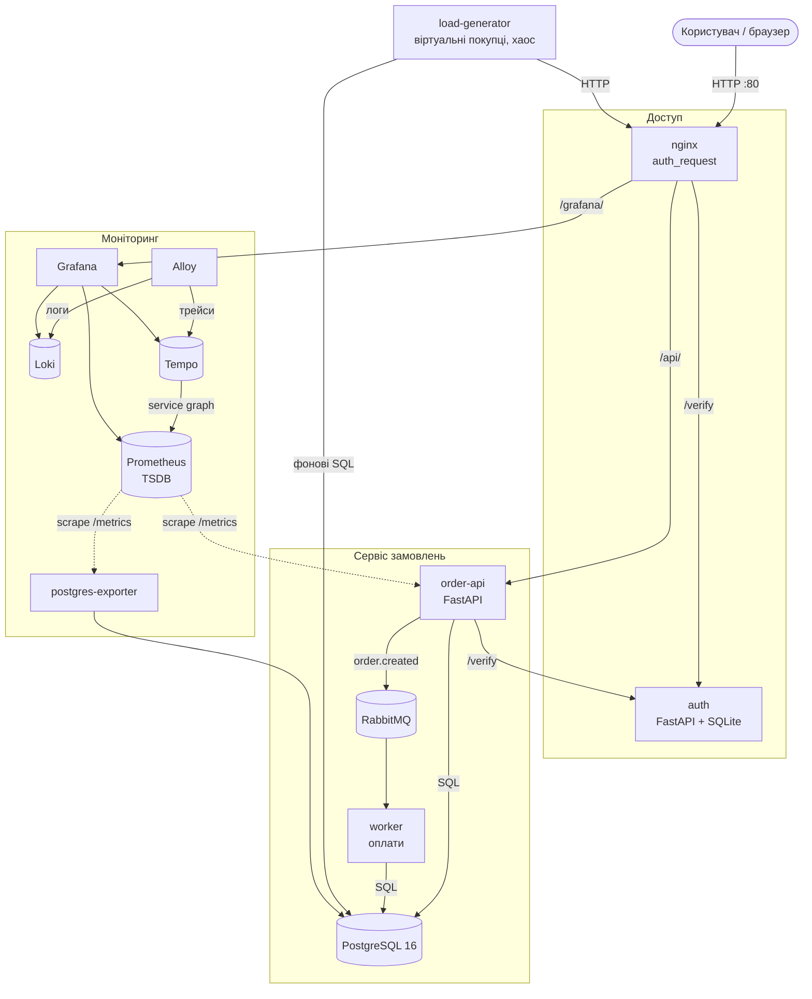

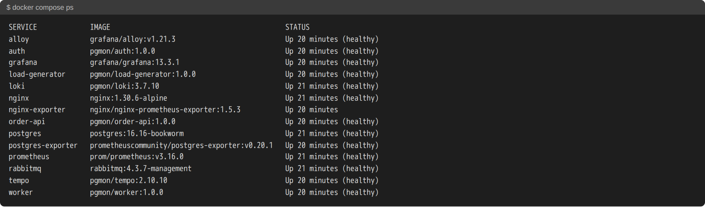

### 1.2. Принципи побудови

- **Єдина точка входу.** Назовні публікується лише порт 80 (nginx). Grafana, Prometheus, Loki, Tempo і СУБД доступні тільки всередині Docker-мережі.
- **Інфраструктура як код.** Конфігурація всіх компонентів, дашборди й алерти лежать у репозиторії і застосовуються автоматично (provisioning), без ручних налаштувань.
- **Відтворюваність.** Версії всіх образів і Python-пакетів зафіксовані, секрети винесені в `.env`, а стартовий порядок задано через healthchecks і `depends_on: condition: service_healthy`.
- **Обмеження ресурсів.** Кожен контейнер має ліміт пам'яті; сума лімітів 3984 MiB, фактичне споживання в нормальному режимі близько 1.2 GiB.

---

## 2. Предметна область і схема бази даних

### 2.1. Бізнес-процес

1. Покупець переглядає та шукає товари в каталозі.
2. Покупець оформлює замовлення. В одній транзакції сервіс перевіряє наявність товарів (`SELECT … FOR UPDATE`), створює замовлення і його позиції та зменшує залишки на складі. Якщо якогось товару бракує, сервіс повертає HTTP 409.
3. Після фіксації транзакції сервіс публікує подію `order.created` у RabbitMQ.
4. Worker отримує подію, реєструє спробу оплати, імітує звернення до платіжного шлюзу (0.5–3 с, приблизно 10% відмов) і переводить замовлення в статус `paid` або `failed`. При відмові worker повертає товари на склад.
5. Фонові процеси поповнюють склад, змінюють ціни, архівують і видаляють старі замовлення.

### 2.2. Схема БД

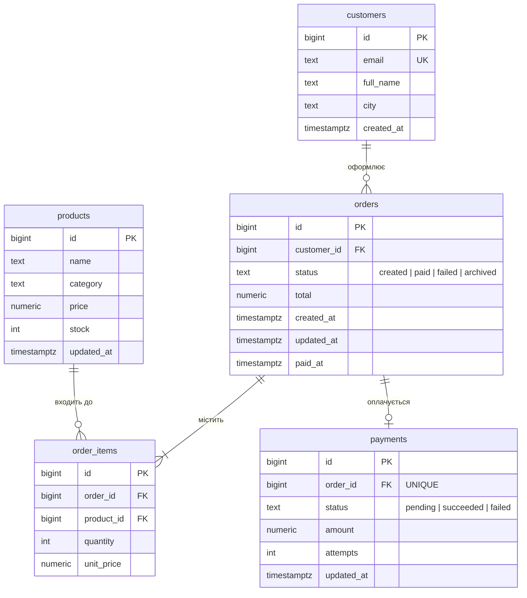

**Індекси:**

| Індекс | Призначення |
|---|---|
| `products (category, price)` | перегляд категорії з сортуванням за ціною |
| `products USING gin (name gin_trgm_ops)` | пошук `ILIKE '%…%'` за назвою (розширення `pg_trgm`) |
| `products (stock) WHERE stock < 20` | частковий індекс для задачі поповнення складу |
| `orders (customer_id, created_at DESC)` | історія замовлень покупця |
| `orders (status, created_at)` | вибірки за статусом, архівація |
| `order_items (order_id)`, `order_items (product_id)` | з'єднання й каскадне видалення |
| `payments (order_id)` UNIQUE | одна оплата на замовлення, ідемпотентність worker |

**Цілісність:** зовнішні ключі (`order_items` і `payments` з `ON DELETE CASCADE`) та CHECK-обмеження (`price > 0`, `stock >= 0`, допустимі статуси).

**Сид-дані:** 1000 товарів у 8 категоріях, 500 клієнтів і близько 3000 замовлень за останній тиждень.

**Ролі СУБД** (принцип найменших привілеїв):

| Роль | Хто використовує | Права |
|---|---|---|
| `app` | order-api, worker | SELECT/INSERT/UPDATE на робочих таблицях |
| `generator` | load-generator | плюс DELETE (архівація, видалення) |
| `exporter` | postgres-exporter | `pg_monitor` (лише статистика) |

Окремі ролі дають змогу бачити в `pg_stat_activity` і `pg_stat_statements`, який компонент створює навантаження.

### 2.3. Налаштування PostgreSQL для моніторингу

- `shared_preload_libraries = 'pg_stat_statements'`, `pg_stat_statements.track = all`: статистика за кожним нормалізованим запитом.
- `track_io_timing = on`: час операцій вводу-виводу.
- `log_min_duration_statement = 500ms`, `log_lock_waits = on`, `deadlock_timeout = 1s`: повільні запити й очікування блокувань потрапляють у лог (а звідти в Loki).

---

## 3. Опис компонентів

### 3.1. Генератор навантаження (`load-generator`)

Програма на Python 3.12 (asyncio):

- **Віртуальні покупці.** Кількість задає змінна `USERS`, сумарну інтенсивність `RPS`. Покупці виконують зважений набір дій: перегляд категорії, пошук, картка товару, оформлення замовлення, перегляд своїх замовлень. Інтервали між діями мають експоненційний розподіл (пуассонівський потік). Покупці авторизуються сервісним акаунтом (`POST /api/token`) і звертаються до API через nginx, як і зовнішні клієнти.
- **Фонові задачі** (прямі SQL-запити):

| Задача | Період | SQL |
|---|---|---|
| поповнення складу | 20 с | `UPDATE products … WHERE stock < 20` |
| зміна цін | 30 с | `UPDATE products SET price = …` (вибірка випадкових товарів) |
| архівація | 60 с | `UPDATE orders SET status='archived'` для оброблених замовлень, старших за 15 хв |
| видалення | 120 с | пакетний `DELETE` архівних замовлень, старших за добу |

- **Керування хаосом.** Ендпоінт `POST /chaos` (див. розділ 6).

### 3.2. Order API (`order-api`)

Сервіс на FastAPI із пулом з'єднань psycopg 3. Ендпоінти: `GET /products`, `GET /products/{id}`, `POST /orders`, `GET /orders/{id}`, `GET /orders`, а також `/health` і `/metrics`.

Кожен бізнес-запит вимагає Bearer JWT, який сервіс перевіряє викликом `GET http://auth/verify`. Тому перевірка авторизації видна в трейсі окремим спаном.

Щоб конкурентні замовлення не створювали взаємних блокувань, рядки товарів блокуються **в порядку зростання id**. Подія публікується лише після COMMIT. Якщо публікація не вдалася, замовлення лишається в статусі `created`, і фонова задача сервісу через 60 с публікує його повторно (спрощений патерн transactional outbox).

### 3.3. Worker оплат (`worker`)

Споживач черги `payments.order-created` на aio-pika з prefetch = 10:

- ручне підтвердження (`ack`) лише після фіксації транзакції в БД;
- при помилці обробки повідомлення один раз повертається в чергу, а повторна невдача відправляє його в **dead-letter queue** `payments.order-created.dlq`;
- ідемпотентність: оплата реєструється через `INSERT … ON CONFLICT`, а статус замовлення повторно перевіряється під блокуванням рядка.

### 3.4. RabbitMQ

| Об'єкт | Тип | Призначення |
|---|---|---|
| `orders` | topic exchange | події замовлень (`order.created`) |
| `payments.order-created` | durable queue, `x-dead-letter-exchange` | черга оплат |
| `orders.dlx` → `payments.order-created.dlq` | fanout + queue | повідомлення, які не вдалося обробити |
| `control` | fanout exchange | розсилка режиму хаосу в order-api і worker |

Метрики черг (довжина, unacked, consumers) віддає вбудований плагін `rabbitmq_prometheus`.

---

## 4. Підсистема спостережуваності

### 4.1. Метрики (Prometheus)

Prometheus опитує 12 цілей кожні 15 с і зберігає ряди у вбудованій TSDB з retention 15 днів. Увімкнено зберігання exemplars і прийом remote write (від Tempo).

**Метрики СУБД** (postgres-exporter):

| Метрика | Що показує |
|---|---|
| `pg_stat_activity_count{state}` | з'єднання за станами (active, idle, idle in transaction) |
| `pg_stat_database_xact_commit / xact_rollback` | TPS |
| `pg_stat_database_blks_hit / blks_read` | cache hit ratio |
| `pg_locks_count{mode}` | блокування за режимами |
| `pg_stat_database_deadlocks` | взаємні блокування |
| `pg_stat_activity_max_tx_duration` | найдовша транзакція |
| `pg_database_size_bytes`, `pg_stat_user_tables_table_size_bytes` | розмір БД і таблиць |
| `pg_stat_user_tables_n_dead_tup`, `seq_scan`, `idx_scan` | мертві кортежі, тип сканування |
| `pg_stat_statements_*` | час і кількість викликів кожного запиту, топ повільних |

**Метрики застосунку** (`prometheus_client`):

| Метрика | Тип | Мітки |
|---|---|---|
| `http_request_duration_seconds` | histogram з exemplars (`trace_id`) | method, route, status |
| `db_query_duration_seconds` | histogram | operation |
| `orders_created_total`, `orders_rejected_total` | counter | reason |
| `orders_processed_total` | counter | status (paid, failed, duplicate, dead_lettered, …) |
| `payment_processing_duration_seconds` | histogram | — |
| `auth_login_total`, `auth_verify_total`, `auth_denied_total`, `auth_users` | counter / gauge | method, result, scope, reason, role |

Мітка `route` містить шаблон маршруту (`/orders/{order_id}`), а не фактичний шлях, тому кардинальність рядів обмежена.

### 4.2. Логи (Loki)

Усі Python-сервіси пишуть у stdout структуровані JSON-логи:

```json
{"ts": "2026-11-15T14:37:54.123+00:00", "level": "info", "service": "order-api",
 "message": "order created", "trace_id": "5125e6ef2d049f04424eab48e43dfe63",
 "span_id": "a1b2c3d4e5f60718", "order_id": 4358, "total": "1435.55"}
```

Grafana Alloy знаходить контейнери проєкту через Docker API, присвоює мітки `service` і `level` (розбираючи формати JSON, logfmt, PostgreSQL і RabbitMQ), а `trace_id` і `span_id` записує як structured metadata. trace_id не робиться міткою, щоб не роздувати кількість потоків. nginx пише access-лог у JSON.

### 4.3. Трейси (Tempo)

У кожному Python-сервісі налаштовано OpenTelemetry SDK з автоінструментацією FastAPI, httpx, psycopg, aio-pika і sqlite3. Спани експортуються по OTLP/HTTP в Alloy, звідти в Tempo.

Контекст трейсу (W3C `traceparent`) передається в HTTP-заголовках і **в заголовках повідомлень RabbitMQ**. Тому одна операція покупця від генератора до запису оплати worker-ом утворює єдиний трейс:

```text
load-generator → nginx → order-api → auth (+SQLite) → PostgreSQL → RabbitMQ → worker → PostgreSQL
```

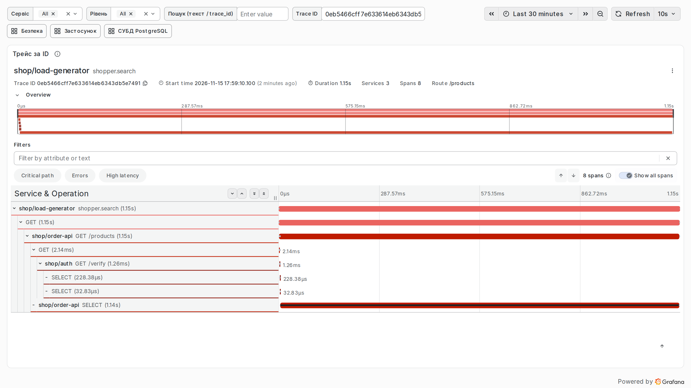

Metrics generator Tempo будує з трейсів **service graph** (`traces_service_graph_*`) і **span metrics** (`traces_spanmetrics_*`) та записує їх у Prometheus.

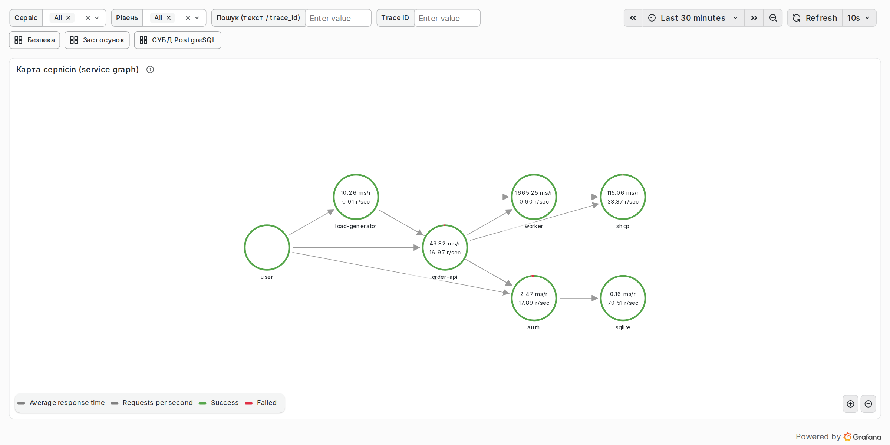

### 4.4. Кореляція сигналів

| Перехід | Механізм |
|---|---|
| метрика → трейс | exemplars у `http_request_duration_seconds` (ромбики на графіку латентності) |
| лог → трейс | derived field `trace_id` у datasource Loki |
| трейс → лог | `tracesToLogsV2` у datasource Tempo (фільтр за `service` і `trace_id`) |
| трейс → метрики | `tracesToMetrics` і service map |

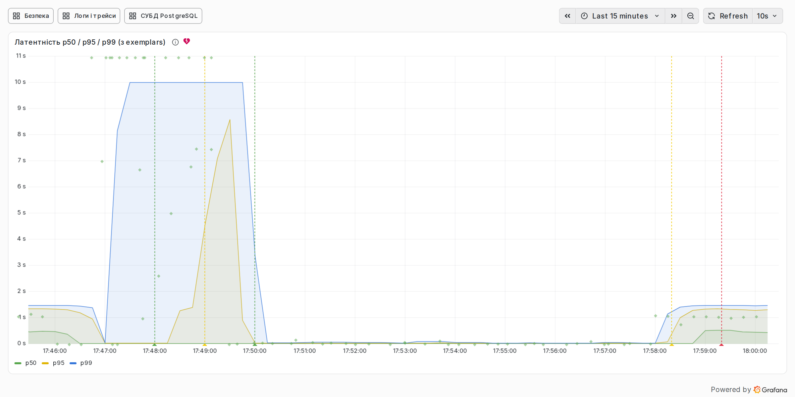

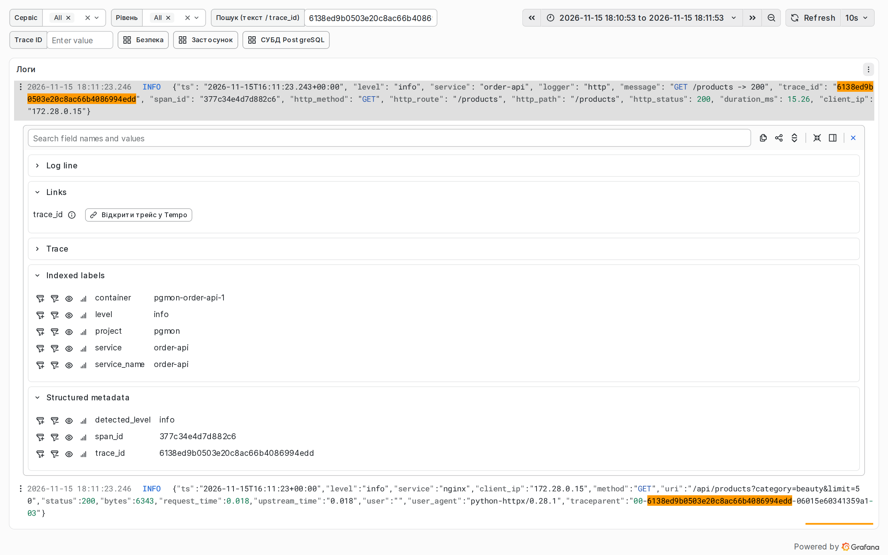

### 4.5. Візуалізація (Grafana)

Datasources, дашборди й алерти створюються з файлів provisioning. Дашборди генерує Python-скрипт `grafana/dashboards_src/build.py`. Так JSON-описи виходять однаковими за стилем, а алерти посилаються на відповідні панелі.

| Дашборд | Призначення |
|---|---|
| СУБД PostgreSQL | з'єднання, TPS, cache hit ratio, блокування, deadlocks, розміри, топ повільних запитів |
| Застосунок | RPS, p50/p95/p99, помилки, замовлення, оплати, черга RabbitMQ |
| Безпека | входи, відмови 401/403, throttling, джерела атак |
| Логи і трейси | пошук логів, service graph, вибірки трейсів, span metrics |

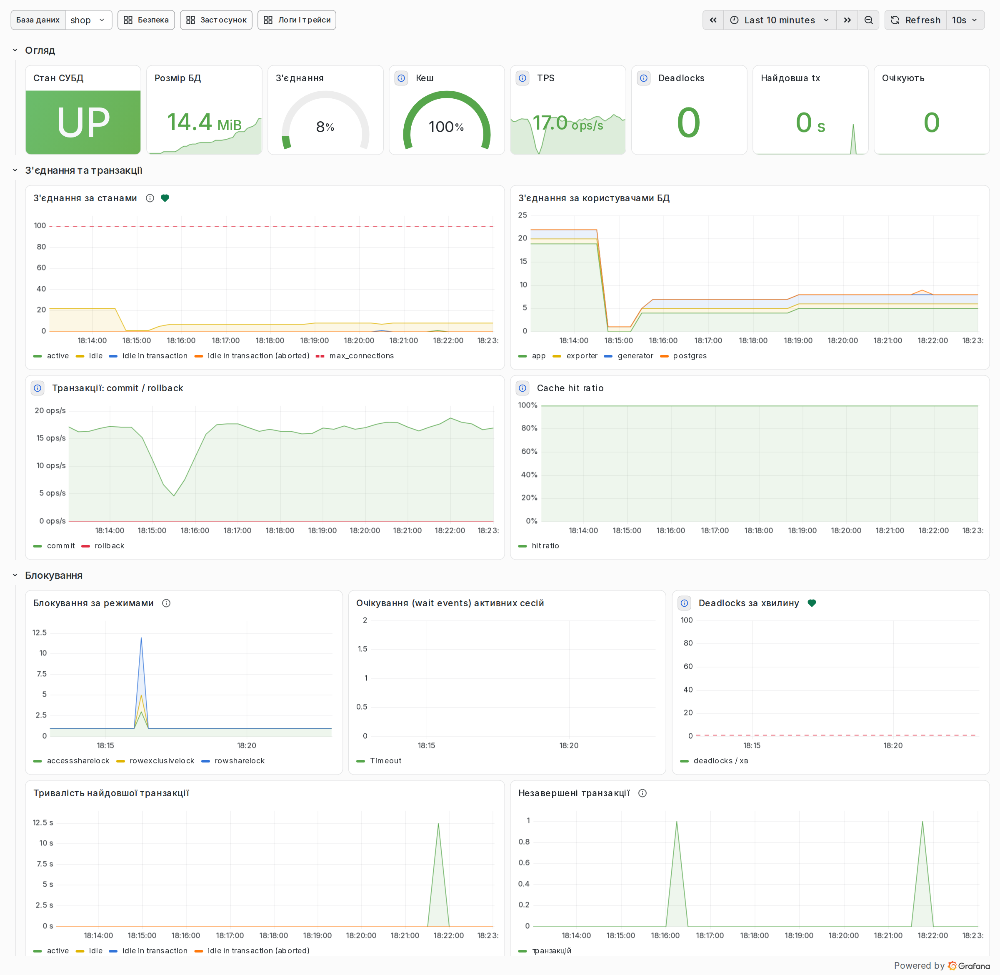

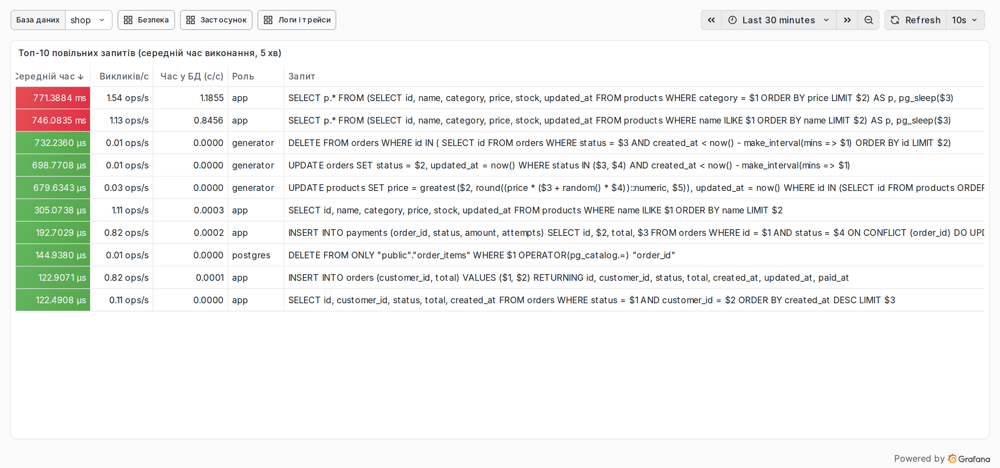

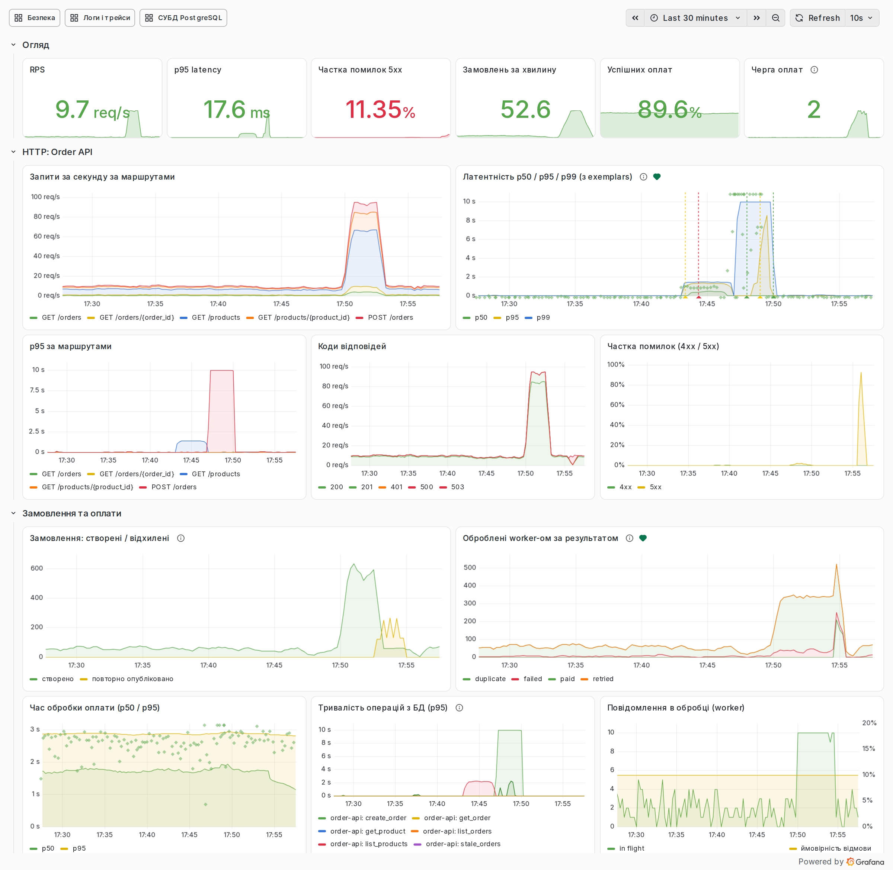

### 4.6. Алерти

Використовується вбудований Grafana Alerting. Кожне правило складається з PromQL-запиту, редукції `last` і порогу.

| Алерт | Умова | Важливість |
|---|---|---|
| Забагато з'єднань із БД | з'єднань > 50% `max_connections`, 1 хв | warning |
| Виявлено deadlock | `increase(pg_stat_database_deadlocks[2m]) > 0` | warning |
| p95 латентності Order API | > 500 мс, 1 хв | critical |
| Черга оплат зростає | > 30 повідомлень і похідна > 0, 1 хв | warning |
| Висока частка невдалих оплат | > 30%, 1 хв | warning |
| Сплеск невдалих входів | > 20 за хвилину, 30 с | critical |
| Ціль моніторингу недоступна | `up == 0`, 1 хв | critical |

Сповіщення надходять на webhook і записуються в лог (`event="alert"`), тож історія спрацювань доступна в Loki.

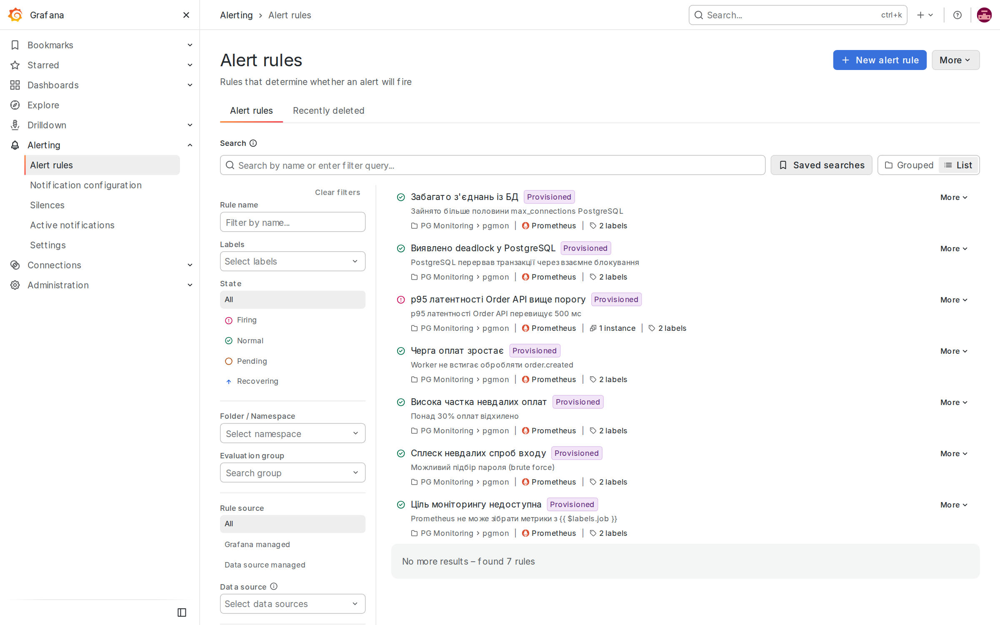

---

## 5. Авторизація і безпека

### 5.1. Сервер авторизації

Сервіс `auth` (FastAPI + SQLite) зберігає три таблиці:

| Таблиця | Вміст |
|---|---|
| `users` | username, `password_hash` (bcrypt), role (admin / viewer / service), is_active |
| `login_attempts` | журнал усіх спроб входу: логін, IP, метод, результат |
| `revoked_tokens` | ідентифікатори (`jti`) відкликаних при виході токенів |

| Ендпоінт | Призначення |
|---|---|
| `GET/POST /login` | HTML-форма; при успіху встановлює HttpOnly-cookie з JWT (SameSite=Lax) і робить redirect на `next` (лише відносні шляхи, захист від open redirect) |
| `POST /api/token` | JSON-логін для сервісів, повертає JWT |
| `GET /verify` | перевіряє cookie або Bearer, підпис, термін дії, відкликання та активність користувача; відповідає 200 із заголовками `X-User` і `X-Role`, 401 або 403 (параметр `scope`: any / grafana / admin) |
| `GET/POST /logout` | відкликає токен і видаляє cookie |
| `/api/users` | CRUD користувачів, лише для ролі admin |

**Захист від підбору паролів:** після 10 невдалих спроб за 5 хвилин з однієї IP для одного логіна сервер відповідає 429. Для невідомих логінів також виконується bcrypt-перевірка, щоб час відповіді не видавав, чи існує такий користувач.

Роль при кожній перевірці береться з БД, а не з токена, тому зміна ролі або деактивація користувача діють одразу.

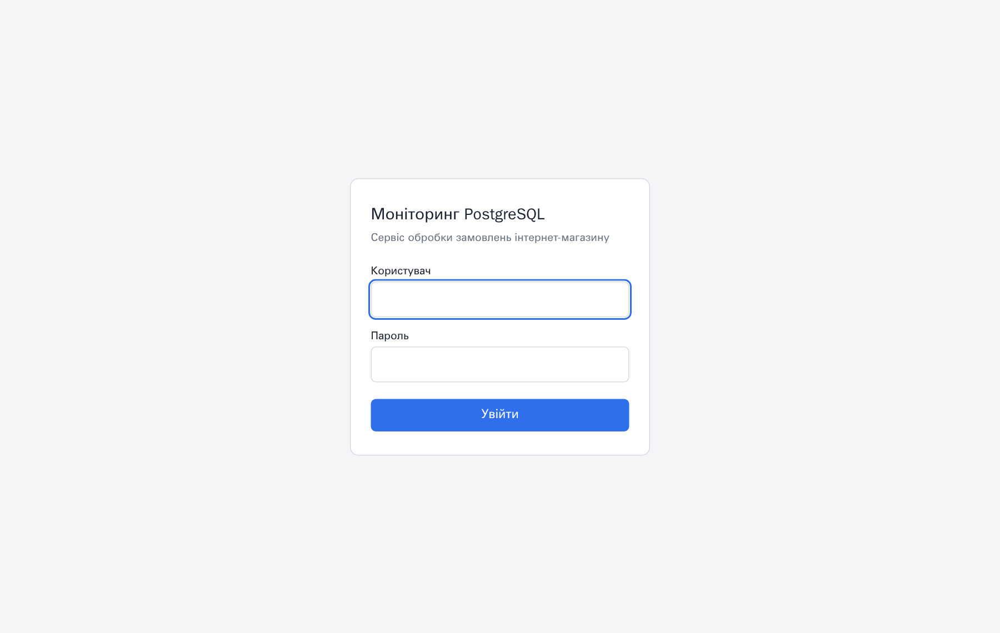

### 5.2. Інтеграція з nginx і Grafana

- nginx для кожного запиту до `/grafana/`, `/prometheus/` і `/chaos` робить підзапит `auth_request` до `/verify`. Без валідної сесії користувач отримує redirect на `/login?next=…`, а за браком прав сторінку 403.
- Grafana працює в режимі **auth.proxy**. nginx передає `X-WEBAUTH-USER` і `X-WEBAUTH-ROLE` (admin → Admin, viewer → Viewer), а Grafana приймає ці заголовки **лише від фіксованої IP-адреси nginx**. Вбудована форма входу, basic auth і анонімний доступ вимкнені. Будь-які заголовки `X-WEBAUTH-*` від клієнта nginx перезаписує.
- Користувач `admin` збігається з внутрішнім адміністратором Grafana, тому отримує права Grafana Server Admin.
- `/prometheus/` і `/chaos` доступні лише ролі admin; Order API приймає запити з будь-якою роллю за наявності Bearer JWT.

### 5.3. Матриця доступу

| Ресурс | Без входу | viewer | admin | service |
|---|---|---|---|---|
| Grafana | redirect на вхід | перегляд | повний доступ | 403 |
| Prometheus UI | redirect на вхід | 403 | ✓ | 403 |
| Керування хаосом | 401 | 403 | ✓ | 403 |
| Order API | 401 | ✓ | ✓ | ✓ |
| CRUD користувачів | 401 | 403 | ✓ | 403 |

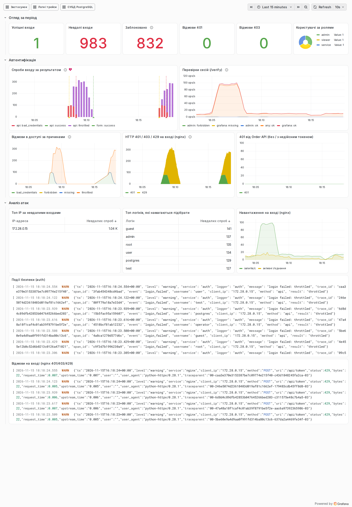

---

## 6. Відтворення проблем продуктивності (режими хаосу)

Перемикання: `make chaos MODE=<режим>` або `POST /chaos` (роль admin).

| Режим | Механізм | Симптоми | Алерт |
|---|---|---|---|
| `slow_queries` | order-api додає `pg_sleep(0.3–1.2)` у SQL каталогу | p95 ≈ 1.2 с; запит з `pg_sleep` на першому місці в pg_stat_statements; довгі SQL-спани | p95 латентності |
| `lock_contention` | 30 сесій оновлюють 5 «гарячих» рядків у випадковому порядку в довгих транзакціях | wait events `Lock` (до 30 сесій), `idle in transaction`, сотні deadlocks, 55% з'єднань | з'єднання, deadlock, p95 |
| `traffic_spike` | ×10 RPS | черга оплат > 300 повідомлень, worker не встигає (prefetch 10) | черга зростає |
| `brute_force` | ~5 невдалих логінів/с | ~285 невдалих входів/хв, більшість отримує 429 | невдалі входи |
| `payment_failures` | worker відхиляє ~70% оплат | 68% невдалих оплат, повернення stock | частка невдалих оплат |

Наведені значення виміряно під час тестування: кожен алерт перейшов у стан Firing через 80–140 с після ввімкнення режиму.

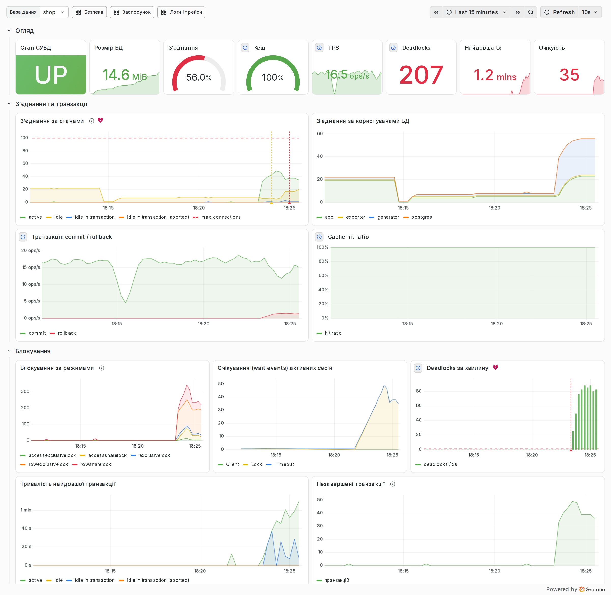

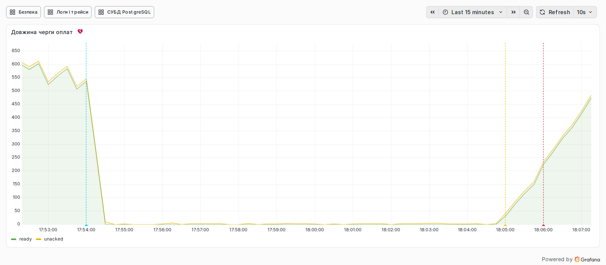

### 6.1. Приклад розслідування інциденту

1. Спрацював алерт «p95 латентності Order API вище порогу».
2. На дашборді «Застосунок» видно, що зросла латентність саме маршруту `GET /products`.
3. Exemplar на графіку веде до конкретного повільного трейсу. У ньому майже весь час припадає на SQL-спан у PostgreSQL.
4. Таблиця pg_stat_statements на дашборді «СУБД PostgreSQL» показує, який нормалізований запит повільний і скільки разів його викликано.
5. Перехід «Logs for this span» відкриває логи order-api з тим самим `trace_id`.

Отже, шлях від симптому до причини (конкретного SQL-запиту) займає кілька кліків і не потребує доступу до серверів.

---

## 7. Розгортання і тестування

- Запуск: `make up` (або `cp .env.example .env && docker compose up -d`).
- `make smoke` автоматично перевіряє 21 умову:
  - стан контейнерів і targets Prometheus;
  - redirect на логін і доступ після входу;
  - ролі Grafana, provisioning дашбордів і алертів;
  - 401 і 403 для неавторизованих запитів, закриті порти;
  - логи кожного сервісу в Loki;
  - наскрізний трейс у Tempo, exemplars у Prometheus;
  - обробку замовлень.
- Кожен етап розробки перевірявся повним перезапуском з видаленням даних (`docker compose down -v`).

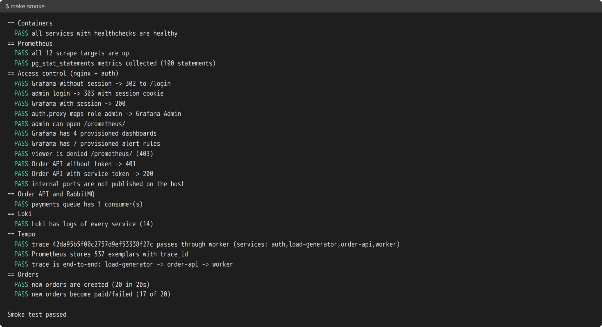

---

## Висновки

У роботі спроєктовано й реалізовано систему моніторингу продуктивності PostgreSQL сервісу обробки замовлень інтернет-магазину, яка виконує всі поставлені вимоги:

1. PostgreSQL 16 працює в Docker з розширенням pg_stat_statements; схема БД нормалізована, з індексами й обмеженнями цілісності.
2. Програма на Python генерує реалістичне навантаження і підтримує дані в актуальному стані: використовуються всі типи SQL-операцій.
3. Метрики збирає Prometheus і зберігає у вбудованій TSDB; візуалізація реалізована чотирма дашбордами Grafana.
4. Логи збираються в Loki, трейси в Tempo; три типи сигналів пов'язані переходами (exemplars, derived fields, traces-to-logs).
5. Доступ закрито власним сервером авторизації на Python і SQLite у зв'язці з nginx `auth_request` і режимом auth.proxy у Grafana.
6. Сервіси обмінюються повідомленнями через RabbitMQ з гарантіями доставки (publisher confirms, manual ack, DLQ), а контекст трейсу проходить крізь брокер.
7. Усі компоненти працюють у Docker-контейнерах і запускаються однією командою.

Режими хаосу показали, що система виявляє типові проблеми продуктивності: повільні запити, конкуренцію за блокування, deadlocks, перевантаження, атаки на автентифікацію й збої зовнішніх залежностей. Вона сповіщає про них протягом 1–2 хвилин і дає змогу дійти до першопричини за кілька переходів між сигналами.

**Можливі напрями розвитку:** реплікація PostgreSQL і моніторинг лагу реплікації; пул з'єднань PgBouncer; зовнішні канали сповіщень (Telegram, email); TLS на вході; аналіз планів виконання (`auto_explain`).

---

## Список джерел (заготовка)

1. PostgreSQL 16 Documentation. The Statistics Collector; pg_stat_statements. — https://www.postgresql.org/docs/16/
2. Prometheus Documentation. — https://prometheus.io/docs/
3. Grafana Documentation (Alerting, Provisioning, Auth Proxy). — https://grafana.com/docs/grafana/latest/
4. Grafana Loki Documentation. — https://grafana.com/docs/loki/latest/
5. Grafana Tempo Documentation. — https://grafana.com/docs/tempo/latest/
6. Grafana Alloy Documentation. — https://grafana.com/docs/alloy/latest/
7. OpenTelemetry Python Documentation. — https://opentelemetry.io/docs/languages/python/
8. RabbitMQ Documentation (Dead Letter Exchanges, Prometheus). — https://www.rabbitmq.com/docs
9. nginx Documentation: ngx_http_auth_request_module. — https://nginx.org/en/docs/
10. RFC 7519. JSON Web Token (JWT).
